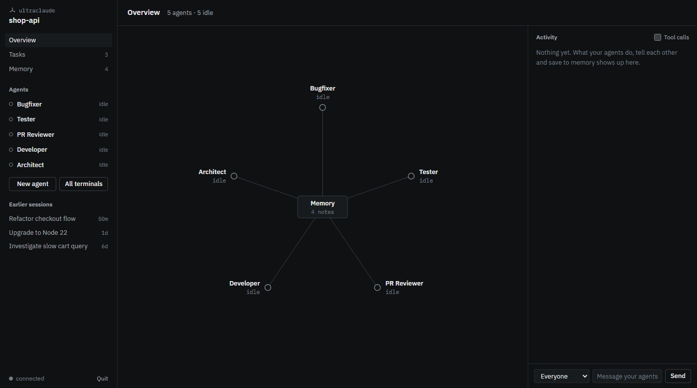
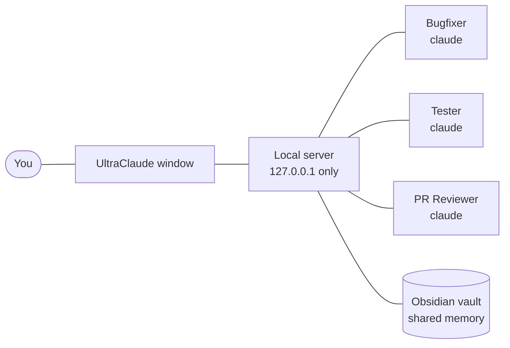

<p align="center">
  
</p>

<p align="center">
  <b>Run a whole team of Claude Code agents side by side.</b><br>
  Every agent has a role. All of them share one memory in Obsidian.<br>
  They see what the others are doing, message each other and hand work over.
</p>

<p align="center">
  <a href="#quick-start">Quick start</a> ·
  <a href="#what-you-get">What you get</a> ·
  <a href="#shared-memory">Shared memory</a> ·
  <a href="#earlier-sessions">Earlier sessions</a> ·
  <a href="#how-it-works">How it works</a>
</p>

<p align="center">
  
  <br>
  <sub>The real interface. Recorded with scripted demo agents, so no tokens were harmed.</sub>
</p>

## Why

One Claude Code window does one thing at a time. But a pull request is waiting for review while a bug needs fixing and somebody should really write that ticket.

UltraClaude opens as many Claude Code sessions as you want for the same project and turns them into a team:

- **Roles.** Bugfixer, Developer, PR Reviewer, Tester, Ticket Writer, Architect, Docs Writer, Coordinator, or one you describe yourself.
- **One memory.** What one agent learns, every agent knows. It lives in an Obsidian vault you can read and edit.
- **They talk.** Agents message each other, hand work over and tell you when they are done or stuck.
- **You see everything.** One window shows who is working, who is idle and who is waiting for you.

## Quick start

<p align="center">
  
</p>

You need [Node.js](https://nodejs.org) 20 or newer and [Claude Code](https://claude.com/claude-code): the `claude` command works in your terminal and you are signed in. Obsidian is optional, because the vault is a normal folder of Markdown files.

```bash
npm install -g github:ZH-NICO/ultraclaude
```

Then, in any project folder:

```bash
cd my-project
ultraclaude
```

A window opens for that folder. Pick a role and your first agent starts.

The first time Claude Code runs in a folder, it asks in the agent's terminal whether you trust the folder. Select "Yes" there.

<details>
<summary>Install from a clone instead</summary>

```bash
git clone https://github.com/ZH-NICO/ultraclaude.git
cd ultraclaude
npm install
npm link
```

</details>

## What you get

<table>
  <tr>
    <td width="50%"></td>
    <td width="50%"></td>
  </tr>
  <tr>
    <td><b>Overview.</b> Every agent around the shared memory, with its state and what it is doing right now. Messages and memory access move through the graph as they happen. Next to it, the activity feed and a box to message your agents.</td>
    <td><b>Terminals.</b> The real Claude Code terminals, one at a time or all side by side. The sidebar always shows who is working, idle or waiting for you.</td>
  </tr>
  <tr>
    <td></td>
    <td></td>
  </tr>
  <tr>
    <td><b>Tasks.</b> A board with Open, In progress and Done. You and the agents add tasks. Whoever gets one assigned is told.</td>
    <td><b>Memory.</b> Every note in the vault, to filter and read, with a jump into Obsidian.</td>
  </tr>
</table>

Colour only ever means state: green is working, amber needs you. The window follows your system's light or dark theme.

## Working with several agents

- **Select agents.** Tick the box in front of an agent in the sidebar. A bar appears with **Open together** (just those terminals side by side), **Stop** and **Remove** for the whole selection.
- **Hide a terminal.** In All terminals every pane has a **−** next to Stop. It takes that terminal out of the view and leaves the agent running. A bar on top shows how many are hidden, with **Show all** to bring them back.
- **Paste images with Ctrl+V.** Copy a screenshot or a picture and press Ctrl+V in an agent's terminal. The image is attached right away as `[Image #1]`, no file path needed. Text still pastes as usual.
- **The prompt stays put.** Agents use Claude Code's fullscreen rendering: the prompt and status line stay at the bottom while you scroll the chat with the mouse wheel. To turn it off, set `"tui"` to something other than `"fullscreen"` in your Claude Code settings.
- **Colours like a normal terminal.** Agents run with full colour, also when UltraClaude itself was started from a shell that has `NO_COLOR` set.
- **Every chat on one map.** Click **ultraclaude** at the top left. Every Claude Code chat on your computer shows up as a dot: one row per folder, newest on the right, bigger dots for longer chats. Pick one to continue it here, or open its folder in its own UltraClaude window.

## Roles

| Role | What it does |
| --- | --- |
| Bugfixer | Finds root causes and fixes bugs |
| Developer | Implements tickets and features |
| PR Reviewer | Reviews pull requests and diffs |
| Tester | Writes and runs tests |
| Ticket Writer | Turns ideas and bugs into clear tickets |
| Architect | Plans the approach and records decisions |
| Docs Writer | Keeps README, guides and changelogs current |
| Coordinator | Splits up the work and keeps track of it |
| Custom role | You describe what the agent should do |

"New agent" also lets you set a name, extra instructions, a first task, the model, the permission mode and a separate git worktree.

## Shared memory

The default vault is `~/UltraClaudeVault`. Change it with `ultraclaude vault <path>`, for example to a folder inside a vault you already use.

```
UltraClaudeVault/
  Global/                      knowledge for all your projects
  Projects/<project>/
    Memory/                    what the agents learned: decisions, architecture, gotchas
    Claude Code/               what Claude Code had already saved for this folder
    Agents/                    one note per agent with its role and current status
    Tasks/<project> Board.md   the board as a checklist
    Log/2026-01-31.md          journal: who did what, and when
```

To see it in Obsidian, choose "Open folder as vault" and pick the vault folder. Notes you write yourself in `Memory/` or `Global/` are found by the agents too.

## Earlier sessions

Already used Claude Code in a folder? UltraClaude picks that up the moment you open it there.

- **Sessions.** Every earlier Claude Code session of the folder is listed in the sidebar. Click one and it continues as an agent: the same conversation, now with the team tools.
- **Memory.** The notes Claude Code saved for the folder are mirrored into the vault under `Claude Code/`, next to a list of the earlier sessions. Every agent can search them and they show up in Obsidian.

## How it works



- `ultraclaude` starts a small local server for the folder you are in and opens the window. The server listens on `127.0.0.1` only and requires an access token. Closing the window leaves the agents running. The server exits once no window is open and no agent is running, or when you choose Quit.
- Each agent is a regular `claude` process in a pseudo terminal, started with its role prompt.
- A built-in MCP server gives every agent the team tools: `list_agents`, `send_message`, `read_messages`, `set_status`, `memory_search`, `memory_read`, `memory_write`, `memory_list`, `task_list`, `task_create`, `task_update`.
- Claude Code hooks report to the window what an agent is doing, and they deliver messages: to a busy agent after its next tool call, to an idle agent as new input.
- When an agent starts it gets a briefing: who is on the team, the open tasks and the notes already in memory.
- Only the server writes to the vault, so agents working in parallel do not overwrite each other.
- A project's state (agents, tasks, messages) lives in `<project>/.ultraclaude/`, which git ignores. A stopped agent continues its session the next time you start it.

## Commands

```
ultraclaude               open the window for the current folder
ultraclaude stop          stop the server and all agents of this folder
ultraclaude status        is a server running for this folder?
ultraclaude vault [path]  show or change the vault
ultraclaude --no-open     start the server without a window
```

## Good to know

- All agents work in the same folder. For agents that change code at the same time, use the "Own git worktree" option.
- Every agent uses your Claude quota. Many agents in parallel reach the limit sooner.
- The window is a Chromium app window when Edge or Chrome is installed, otherwise a tab in your default browser.
- UltraClaude is an independent project. It starts the Claude Code you have installed and is not made or endorsed by Anthropic.

## Development

```bash
npm test    # vault, messages, tasks, hooks, MCP, sessions and the HTTP API, without real Claude processes
```

```
bin/ultraclaude.js   command line
src/server.js        HTTP, WebSocket, MCP endpoint and hook endpoint
src/project.js       agents, messages, tasks, hook logic
src/mcp.js           the team tools
src/vault.js         the Obsidian vault
src/history.js       earlier Claude Code sessions and memory of a folder
src/roles.js         roles and the agent prompt
src/hook.js          hook script that Claude Code calls
public/              the interface (no build step)
```

## License

[MIT](LICENSE)
