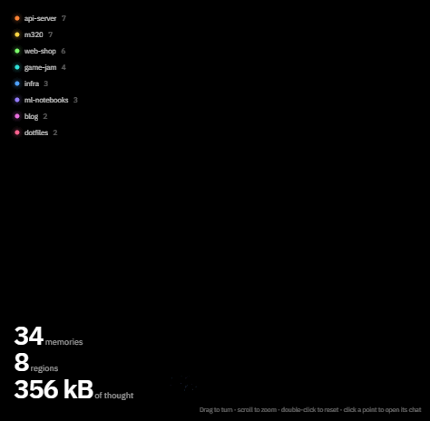
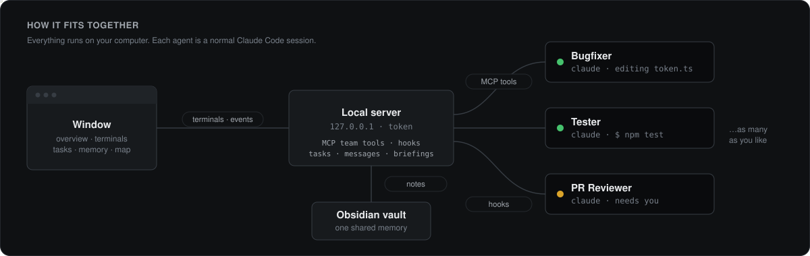

<p align="center">
  
</p>

<p align="center">
  <b>Run a whole team of Claude Code agents in one window.</b><br>
  Every agent has a role. All of them share one memory in Obsidian.<br>
  They see what the others do, message each other and hand work over.
</p>

<p align="center">
  <a href="#quick-start">Quick start</a> ·
  <a href="#what-you-get">What you get</a> ·
  <a href="#your-whole-computer-in-one-brain">Brain</a> ·
  <a href="#shared-memory">Memory</a> ·
  <a href="#keyboard">Keyboard</a> ·
  <a href="#your-account">Account</a> ·
  <a href="#usage">Usage</a> ·
  <a href="#how-it-works">How it works</a>
</p>

<p align="center">
  
  <br>
  <sub>The real interface, recorded with scripted demo agents.</sub>
</p>

## Why

One Claude Code window does one thing at a time. But a pull request is waiting for review while a bug needs fixing and somebody should write that ticket.

UltraClaude opens as many Claude Code sessions as you want for the same project and turns them into a team.

<p align="center">
  
</p>

## Updating

When a new version is out, UltraClaude shows **New update available** in the sidebar and under *Settings → About*. Press **Update now**, then **Restart now**. Installed before version 0.2.0? Run this once, then `ultraclaude` (Windows PowerShell: `ultraclaude.cmd`) again in each project:

```bash
npm.cmd install -g https://github.com/ZH-NICO/ultraclaude/archive/refs/heads/main.tar.gz   # Windows
npm install -g https://github.com/ZH-NICO/ultraclaude/archive/refs/heads/main.tar.gz       # macOS, Linux
```

## Quick start

You need [Node.js](https://nodejs.org) 20 or newer and [Claude Code](https://claude.com/claude-code) (the `claude` command works in your terminal and you are signed in). Obsidian is optional, because the vault is a normal folder of Markdown files.

**Windows** (PowerShell or cmd):

```powershell
npm.cmd install -g https://github.com/ZH-NICO/ultraclaude/archive/refs/heads/main.tar.gz
cd C:\path\to\your\project
ultraclaude.cmd
```

**macOS and Linux:**

```bash
npm install -g https://github.com/ZH-NICO/ultraclaude/archive/refs/heads/main.tar.gz
cd ~/path/to/your/project
ultraclaude
```

> **"Running scripts is disabled on this system"** (`npm.ps1 cannot be loaded`, `PSSecurityException`)? That is Windows PowerShell blocking scripts, which npm and `ultraclaude` are. Type `npm.cmd` and `ultraclaude.cmd` as above, or use the *Command Prompt* instead of PowerShell. If you would rather type just `npm` and `ultraclaude`, you can allow local scripts for your user once: `Set-ExecutionPolicy -Scope CurrentUser RemoteSigned`.

A window opens for that folder. Pick a role and your first agent starts. The first time Claude Code runs in a folder, it asks in the agent's terminal whether you trust the folder. Select "Yes" there.

Run `ultraclaude` (or `ultraclaude.cmd`) again after an update: it replaces the old server and your running agents continue their sessions.

<details>
<summary>Install from a clone instead</summary>

```bash
git clone https://github.com/ZH-NICO/ultraclaude.git
cd ultraclaude
npm install
npm link
```

</details>

## What you get

<table>
  <tr>
    <td width="50%"></td>
    <td width="50%"></td>
  </tr>
  <tr>
    <td><b>Overview.</b> Every agent around the shared memory, with its state and what it is doing. Messages and memory access move through the graph as they happen.</td>
    <td><b>Terminals.</b> The real Claude Code terminals, one at a time or all side by side. Tick agents to open, stop or remove them together, and hide a terminal with <b>−</b>.</td>
  </tr>
  <tr>
    <td></td>
    <td></td>
  </tr>
  <tr>
    <td><b>Tasks.</b> A board with Open, In progress and Done. Whoever gets a task assigned is told.</td>
    <td><b>Memory.</b> The vault's real folders. Make, edit, move, copy and delete notes right here.</td>
  </tr>
</table>

In the Overview every agent is an animated pixel pet, so you see its state from how it moves (see [The pets](#the-pets)). The window follows your system's light or dark theme.

## Your whole computer in one brain

Click **ultraclaude** at the top left to open your **brain**: every file on this computer as a point of light in a slowly turning 3D brain, with its cerebrum, cerebellum and stem, and every Claude Code chat as a brighter neuron among the files of its folder. The first time it opens, UltraClaude reads the **names** of your files in the background (never their contents; the system, installed programs, app data, hidden folders and `node_modules` are left out; up to 400,000 files, of which up to 40,000 are drawn). Each main folder (Documents, Downloads, your code, …) is a region with its own stretch of the spectrum, listed on the left with its count. The brain builds itself from the stem upwards, today's chats pulse, and now and then a few neurons of a region fire together. Drag to turn it, scroll to zoom, double-click for everything. Hover a point to see the file or chat; click it to open its folder, continue the chat, or ask about it.

**Six views, one filter.** The bar above the brain switches between them, and the type, period, size, tag, folder and search box apply to all of them (*Ctrl+K* jumps to the search):

| View | What it shows |
|---|---|
| **Brain** | the 3D brain; with a filter set, the matching files light up |
| **Table** | every matching file with type, size, date, folder and tags; sort by any column, select files, export CSV |
| **Pivot** | any two things against each other (type, extension, main folder, folder, year, month, size, tag), counting files or adding up their size; click a cell to see exactly those files |
| **Timeline** | files per month, coloured by type; click a month to set it as the period everywhere |
| **Storage** | a treemap of where your disk space goes; click to go into a folder |
| **Duplicates** | files with the same name and size, biggest waste first |

**Sort without asking anyone.** Select files in the table (or take all that match, up to 500), name a target folder and optionally sort into subfolders by type, extension, year or month. Duplicates can set the extra copies aside the same way. You get the same plan as from Claude: check it, **Apply**, **Undo**. Nothing is ever deleted. Tag files, and save a view with its filters to open it again with one click. Click a file to see its size, date and a preview of text and pictures.

**Ask your brain.** Next to it is a Claude chat that knows the names of all your files. Ask where something is ("where are my tax documents?"), what a folder holds, or let it sort a folder. It runs through your own Claude Code login. It can search and filter the index, make pivots, find duplicates, open any view for you, tag files, read a file when its content matters, and fly the brain to what it talks about, so you see it light up. It cannot run commands, write or delete. To sort, it proposes a plan of moves; nothing moves until you press **Apply**, nothing is ever overwritten, and **Undo** puts everything back.

Inspired by the look of [mindcorpus.org](https://mindcorpus.org/); drawn by UltraClaude itself, without any of its code or assets. It holds still when your system asks for reduced motion.

<p align="center">
  
  <br>
  <sub>Shown on a made-up chat history.</sub>
</p>

## The pets

Every agent in the Overview is a small pixel crab, and you can tell what it is doing from how it moves rather than from a colour. Idle, it breathes and blinks. Thinking, it sways under a thought bubble. Working, it types on a keyboard. When it needs you, it hops and shows a "!". Starting up, it stretches awake. Stopped, it sleeps with z z z. And when it finishes a turn it jumps for joy. Subagents are small crabs that type along beside their agent. With reduced motion switched on in your system, they stay still. The crab is our own drawing of a Clawd-like character, inspired by [clawd-on-desk](https://github.com/rullerzhou-afk/clawd-on-desk); no artwork from that project is used.

## Subagents

When an agent starts a subagent (Claude Code's Agent tool), it appears in the Overview as a small node hanging off that agent, not off the memory. It grows out of its agent, shows what it is doing while data flows along its link, and when it finishes its result travels back and it folds away. Background subagents stay until they report back.

## Missions

Give the team one goal under **Missions**. A coordinator agent plans the goal into tasks on the board, starts as many helpers as the work needs, with the roles it needs, follows their work and reports back. Each mission is a card with the steps **Plan → Work → Check → Done**, the share of its tasks that are done, the open ones, and the coordinator's final report. **Stop** stops the coordinator and every helper it started. Only the coordinator of a running mission can start agents; it is told to keep the team lean, and a mission stops at 12 helpers as an emergency brake.

## Changes

In a git repository, **Changes** shows what each agent changed. Agents started with *Own worktree* work on their own branch; for each one you see the files, the full diff (uncommitted and new files included) and three buttons: **Commit all**, **Merge into main** (stops cleanly on a conflict and changes nothing), and **Open pull request** (pushes the branch and runs `gh pr create --fill`, if the GitHub CLI is installed). The main folder's uncommitted changes are listed too.

## Cost guard

The guard watches the current 5-hour window against your limit (the one under *Settings → Usage*, or your busiest earlier window). At 80% it warns in the sidebar, with the time the window is full at the current pace. At 95% it stops the running agents, so a forgotten team doesn't use up the rest. **Resume** starts them again, and they continue their sessions. Both marks, auto-resume when a new window starts, and switching it off are under *Settings → Usage*.

## Memory graph

In **Memory**, switch from *List* to *Graph* to see your notes as a network, linked by their `[[wikilinks]]`. Scroll to zoom, drag to move, click a note to open it. Dashed dots are links to notes that don't exist yet; click one to write it. When an agent reads or writes a note, its dot lights up, and new notes appear on their own.

## Replay

Everything your agents do is recorded in the project (`.ultraclaude/events.jsonl`). **Replay** in the sidebar winds it back: drag the slider to any moment and the graph shows who was working, who was waiting for you and what each one was doing. **Play** runs it forward at 1×, 10×, 60× or 300× with the messages and memory access flying through the graph again. A strip above the slider shows when things happened, and quiet stretches are skipped.

## Roles

| Role | What it does |
| --- | --- |
| Bugfixer | Finds root causes and fixes bugs |
| Developer | Implements tickets and features |
| PR Reviewer | Reviews pull requests and diffs |
| Tester | Writes and runs tests |
| Ticket Writer | Turns ideas and bugs into clear tickets |
| Architect | Plans the approach and records decisions |
| Docs Writer | Keeps README, guides and changelogs current |
| Coordinator | Splits up the work and keeps track of it |
| Custom role | You describe what the agent should do |

"New agent" also lets you set a name, extra instructions, a first task, the model, the permission mode and a separate git worktree.

## Keyboard

The terminals behave like Windows Terminal.

| Keys | What happens |
| --- | --- |
| Ctrl+V, Ctrl+Shift+V | Paste. A screenshot or copied image is attached right away as `[Image #1]`, no file path needed |
| Ctrl+C | Copies when text is selected, otherwise interrupts Claude |
| Ctrl+Shift+C | Always copies |
| Shift+Enter, Ctrl+Enter | New line in the prompt instead of sending |
| Ctrl+R, Shift+Tab, Esc, … | Go to Claude Code as usual |
| Ctrl+S, Esc | Save and cancel in the memory editor |

The prompt and status line stay at the bottom while you scroll the chat with the mouse wheel (Claude Code's fullscreen rendering). To turn that off, set `"tui"` to something other than `"fullscreen"` in your Claude Code settings.

## Your account

The window asks you to sign in. The first time you create an account with your name, email and a password. After that you sign in with email and password.

Below the form, **Continue without signing in** opens the window as a guest. A guest has no account: no photo, no saved settings and no access to account tools, and the session ends after 12 hours of not using it. Anyone who can open the window can do this, so if you want a real sign-in every time, turn it off under **Settings → Security → Sign-in screen**.

Bottom left in the sidebar is your profile: your photo (or initials) and your name. It opens **Settings**, a window in the middle of the screen:

| Section | What it does |
| --- | --- |
| **Profile** | Photo, first and last name, email |
| **Appearance** | System, light or dark theme, terminal text size, desktop notifications |
| **Usage** | What your Claude Code chats used, see below |
| **Security** | Change your password, see and end sessions on other devices, delete the account |
| **About** | Version, project and vault paths, keyboard shortcuts |

Accounts are stored on your computer only, in `~/.ultraclaude/users.json`. There is no server and no email, which also means a forgotten password cannot be reset by mail. If you lose it, delete that file and create the account again. Your projects and memory are not touched.

### What protects it

- Passwords are never stored, only a salted scrypt hash. Every account has its own salt, and the file is readable only by you.
- After five wrong passwords an account is locked for a while, longer with every further try. An unknown email and a wrong password give the same answer.
- A session lasts 30 days and lives in an `HttpOnly`, `SameSite=Strict` cookie, so scripts cannot read it and other websites cannot use it. Only a hash of the session key is kept on the computer.
- Everything the window asks for needs a signed-in account, the live terminal connection included. The server listens on `127.0.0.1` only, every call carries a secret from the window's address, and the live connection also checks that it comes from the window itself.
- The page may only load files from the server itself, and cannot be shown inside another site.
- Changing the password signs out every other device. The command line (`ultraclaude stop` and the update restart) uses a separate key that only exists in `<project>/.ultraclaude/server.json`.

This keeps other people, other websites and other programs in your browser out. It does not protect you from malware that runs as you on your computer: that can read your files, as it could for any program.

## Usage

**Settings → Usage** shows what your Claude Code chats have used, read from their history on your computer. Nothing is sent anywhere.

- **The current 5-hour window**: tokens, cost, pace and when it resets, compared with your busiest earlier window or a limit you set.
- **Totals** for today, 7 days, 30 days or all time: tokens (input, output, cache), estimated cost, replies and chats.
- **Tokens per day** for the last 30 days and an **activity map** of the last 26 weeks.
- **Models, projects and recent chats**, each with tokens, cost and share.
- **Export CSV** of the daily numbers.

Costs are what the same tokens would cost at API list prices. A Pro or Max subscription is not billed per token. The percentage Claude shows for your plan is not part of this: reading it would need your Claude login token, and UltraClaude never touches that.

## Shared memory

The default vault is `~/UltraClaudeVault`. Change it with `ultraclaude vault <path>`, for example to a folder inside a vault you already use.

```
UltraClaudeVault/
  Global/                      knowledge for all your projects
  Projects/<project>/
    Memory/                    what the agents learned, and what you write yourself
    Claude Code/               what Claude Code had already saved for this folder
    Agents/                    one note per agent with its role and current status
    Tasks/<project> Board.md   the board as a checklist
    Log/2026-01-31.md          journal: who did what, and when
```

To see it in Obsidian, choose "Open folder as vault" and pick the vault folder. In the **Memory** view you can add notes and folders, edit notes (Ctrl+S saves), rename or move, duplicate, copy text or path, and delete. `Agents/`, `Tasks/` and `Claude Code/` are kept up to date by UltraClaude, so they are read-only there; **Copy into Memory** makes an editable copy.

Already used Claude Code in a folder? Its earlier sessions are listed in the sidebar and continue as agents with one click, and the notes Claude Code saved for the folder are mirrored into the vault.

## How it works

<p align="center">
  
</p>

- `ultraclaude` starts a small local server for the folder you are in and opens the window. It listens on `127.0.0.1` only and requires an access token. Closing the window leaves the agents running. The server exits once no window is open and no agent is running, or when you choose Quit.
- Each agent is a regular `claude` process in a pseudo terminal, started with its role prompt.
- A built-in MCP server gives every agent the team tools: `list_agents`, `send_message`, `read_messages`, `set_status`, `memory_search`, `memory_read`, `memory_write`, `memory_list`, `task_list`, `task_create`, `task_update`.
- Claude Code hooks tell the window what an agent is doing, and they deliver messages: to a busy agent after its next tool call, to an idle agent as new input.
- A new agent gets a briefing: who is on the team, the open tasks and the notes already in memory.
- The server writes agent-made notes to the vault, so agents working in parallel do not overwrite each other.
- A project's state lives in `<project>/.ultraclaude/`, which git ignores. A stopped agent continues its session the next time you start it.

## Commands

```
ultraclaude               open the window for the current folder (updates an outdated server)
ultraclaude stop          stop the server and all agents of this folder
ultraclaude status        is a server running for this folder?
ultraclaude vault [path]  show or change the vault
ultraclaude --no-open     start the server without a window
```

## Good to know

- All agents work in the same folder. For agents that change code at the same time, use the "Own git worktree" option.
- Every agent uses your Claude quota. Many agents in parallel reach the limit sooner.
- The window is a Chromium app window when Edge or Chrome is installed, otherwise a tab in your default browser.
- UltraClaude is an independent project. It starts the Claude Code you have installed and is not made or endorsed by Anthropic.

## Development

```bash
npm test    # accounts, sign-in and who may connect, usage, vault, files, messages, tasks, hooks, MCP, sessions, the chat map and the HTTP API
```

```
bin/ultraclaude.js   command line
src/server.js        HTTP, WebSocket, MCP endpoint and hook endpoint
src/project.js       agents, messages, tasks, hook logic
src/mcp.js           the team tools
src/accounts.js      accounts, passwords, sessions
src/usage.js         token usage read from Claude Code's history
src/vault.js         the Obsidian vault and its files
src/history.js       earlier Claude Code sessions, memory and every chat on the computer
src/roles.js         roles and the agent prompt
src/hook.js          hook script that Claude Code calls
src/version.js       tells an outdated server from an up-to-date one
public/              the interface (no build step)
docs/                the pictures in this README
```

## License

[MIT](LICENSE)
